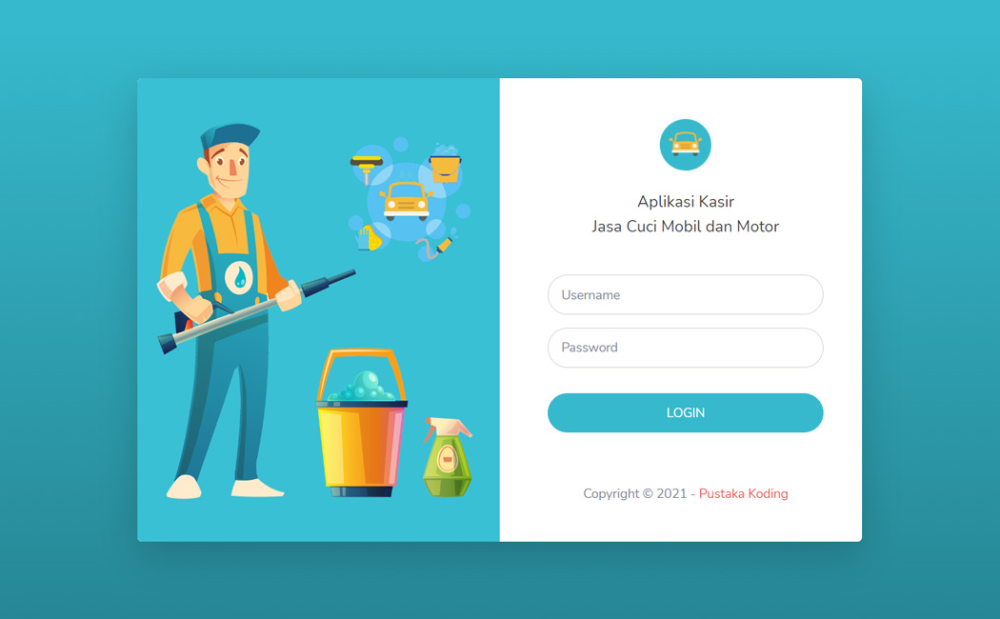

# 👕 Fashion Store Website

<div align="center">


</div>

Website Company Profile untuk toko pakaian (**Clothing Store**) yang dikembangkan menggunakan HTML, CSS, dan Bootstrap 5. Project ini dibuat sebagai media pembelajaran kolaborasi tim menggunakan **Git dan GitHub Remote Repository**.

Setiap anggota tim memiliki tanggung jawab untuk mengembangkan bagian tertentu dari website melalui branch masing-masing. Setelah pekerjaan selesai, perubahan akan dikirimkan ke repository remote untuk disimpan dan diperiksa pada tahap kolaborasi berikutnya.

## 📑 Daftar Isi

1. [Informasi Project](#-1-informasi-project)
   - [Tujuan Project](#tujuan-project)
   - [Fitur dan Bagian Website](#fitur-dan-bagian-website)
2. [Struktur Project](#-2-struktur-project)
   - [Ketentuan Penempatan Assets](#ketentuan-penempatan-assets)
3. [Pembagian Tugas Anggota](#-3-pembagian-tugas-anggota)
   - [Anggota 1 — Alfarizi: Navbar, Social Media, dan Footer](#-anggota-1--alfarizi-navbar-social-media-dan-footer)
   - [Anggota 2 — Lazima: Hero Section dan Services](#-anggota-2---lazima--hero-section-dan-services)
   - [Anggota 3 — Lintang: About](#-anggota-3---lintang--about)
   - [Anggota 4 — Ulfi: Portfolio](#-anggota-4---ulfi-portfolio)
   - [Anggota 5 — Ifan: Contact](#-anggota-5---ifan-contact)
4. [Ketentuan Penggunaan CSS](#-4-ketentuan-penggunaan-css)
   - [Memperbaiki CSS yang Sudah Ada](#a-memperbaiki-css-yang-sudah-ada)
   - [Menambahkan CSS Baru](#b-menambahkan-css-baru)
   - [Ketentuan Komentar CSS](#c-ketentuan-komentar-css)
   - [Contoh Penambahan CSS](#d-contoh-penambahan-css)
5. [Ketentuan Branch Git](#-5-ketentuan-branch-git)
   - [Alur Kolaborasi](#alur-kolaborasi)
6. [Langkah-Langkah GitHub Remote](#-6-langkah-langkah-github-remote)
   - [Clone Repository](#a-clone-repository)
   - [Mengatur Identitas Git](#b-mengatur-identitas-git-jika-belum)
   - [Memastikan Berada di Branch Main](#c-memastikan-berada-di-branch-main)
   - [Membuat dan Berpindah ke Branch Pribadi](#d-membuat-dan-berpindah-ke-branch-pribadi)
   - [Melakukan Perubahan dan Commit](#e-melakukan-perubahan-dan-commit)
   - [Push ke GitHub Remote](#f-push-ke-github-remote)
7. [Materi Pembelajaran: Pull Request dan Merge](#-7-materi-pembelajaran-pull-request-dan-merge)
8. [Ketentuan Penting Kolaborasi](#-8-ketentuan-penting-kolaborasi)
   - [Hal yang Perlu Diperhatikan](#hal-yang-perlu-diperhatikan)
9. [Pengujian Project](#-9-pengujian-project)
10. [Referensi Teknologi](#-10-referensi-teknologi)
11. [Team Members](#-11-team-members)

---

## 📌 1. Informasi Project

| Informasi | Keterangan |
|---|---|
| Nama Project | Fashion Store Website |
| Jenis Project | Company Profile Website |
| Tema | Toko Pakaian / Fashion Store |
| Bahasa | HTML5, CSS3 |
| Framework | Bootstrap 5.2.3 |
| Icon Library | Bootstrap Icons |
| Font | Google Fonts (Raleway) |
| Version Control | Git |
| Remote Repository | GitHub |

### Tujuan Project

Project ini bertujuan untuk membuat website company profile toko pakaian yang memiliki tampilan modern, responsif, dan informatif.

Selain itu, project ini digunakan untuk mempelajari proses kolaborasi pengembangan website menggunakan GitHub Remote dengan beberapa anggota tim yang mengerjakan bagian berbeda dalam satu repository.

### Fitur dan Bagian Website

Website terdiri dari beberapa bagian utama:

1. **Navbar:** Navigasi website, logo toko, dan social media.
2. **Hero Section:** Tampilan utama website yang memperkenalkan toko pakaian.
3. **Services:** Informasi layanan atau keunggulan toko.
4. **About:** Informasi mengenai toko, sejarah, dan identitas brand.
5. **Portfolio:** Galeri produk atau koleksi pakaian.
6. **Contact:** Informasi alamat, WhatsApp, email, dan lokasi toko.
7. **Footer:** Informasi hak cipta dan tautan tambahan.

---

## 📁 2. Struktur Project

Berikut struktur direktori project yang digunakan:

```text
GITHUB-REMOTE-WEBSITE/
│
├── assets/
│   ├── css/
│   │   └── style.css
│   │
│   └── img/
│       ├── about.svg
│       ├── favicon.ico
│       ├── heroes.svg
│       ├── logo.svg
│       │
│       └── portfolio/
│           ├── pustakakoding-aplikasi-kasir-jasa-cuci-mobil-dan-motor.jpg
│           ├── pustakakoding-aplikasi-kasir-penjualan-pulsa.jpg
│           ├── pustakakoding-aplikasi-manajemen-kas-berbasis-web.jpg
│           ├── pustakakoding-aplikasi-manajemen-keuangan-pribadi-single-user.jpg
│           ├── pustakakoding-aplikasi-pengelolaan-arsip-surat.jpg
│           └── pustakakoding-sistem-informasi-persediaan-barang-gudang-material.jpg
│
├── index.html
├── LICENSE.md
└── README.md
```

### Ketentuan Penempatan Assets

Apabila anggota tim ingin menambahkan file pendukung website, ikuti ketentuan berikut.

**1. File CSS**

Seluruh file CSS diletakkan di:

```text
assets/css/
```

Contoh:

```text
assets/css/style.css
assets/css/responsive.css
```

Jika hanya membutuhkan tambahan styling, disarankan menggunakan `style.css` yang sudah tersedia agar tidak terlalu banyak file CSS.

**2. File Gambar**

Seluruh gambar diletakkan di:

```text
assets/img/
```

Contoh:

```text
assets/img/logo-clothing-store.png
assets/img/banner-fashion.jpg
assets/img/about-store.jpg
```

Khusus gambar produk atau koleksi pakaian, letakkan di:

```text
assets/img/portfolio/
```

Contoh:

```text
assets/img/portfolio/product-shirt-black.jpg
assets/img/portfolio/product-hoodie-white.jpg
```

**3. File Icon**

Favicon atau icon website diletakkan di:

```text
assets/img/
```

**4. Ketentuan Penamaan File**

- Gunakan nama file yang jelas dan mudah dipahami.
- Gunakan huruf kecil.
- Pisahkan kata menggunakan tanda hubung (`-`).
- Hindari penggunaan spasi dalam nama file.
- Jangan menggunakan nama file yang sama dengan aset milik anggota lain tanpa koordinasi.

**5. Penggunaan Assets di HTML**

Contoh penggunaan gambar:

```html

```

Contoh penggunaan gambar portfolio:

```html

```

---

## 👥 3. Pembagian Tugas Anggota

Setiap anggota memiliki tanggung jawab untuk memperbaiki dan mengembangkan bagian website sesuai pembagian berikut.

| Anggota | Bagian yang Dikerjakan |
|---|---|
| Anggota 1 - Alfarizi | Navbar, Social Media, dan Footer |
| Anggota 2 - Lazima | Hero Section dan Services |
| Anggota 3 - Lintang | About |
| Anggota 4 - Ulfi | Portfolio |
| Anggota 5 - Ifan | Contact |

### 👑 Anggota 1 — Alfarizi: Navbar, Social Media, dan Footer

**Tanggung jawab:**

- Mengganti logo website sesuai identitas toko pakaian.
- Mengubah nama brand pada navbar.
- Memperbaiki menu navigasi.
- Menyesuaikan link navigasi dengan section website.
- Mengubah link social media.
- Memperbaiki tampilan navbar agar responsif.
- Menyesuaikan warna dan tampilan navbar dengan tema toko pakaian.
- Mengubah informasi copyright pada footer.
- Menyesuaikan link tambahan pada footer.

**Lokasi kode di `index.html`:**

Cari bagian yang diawali dengan komentar:

```html
<!-- Navbar -->
<nav class="navbar navbar-expand-lg navbar-light py-4 bg-nav">
       <div class="container">
           <!-- Brand -->
           <a class="navbar-brand" href="https://pustakakoding.com">
               
               <span class="text-body fs-4 fw-bolder">Digital Creative</span>
           </a>
           <button class="navbar-toggler" type="button" data-bs-toggle="collapse" data-bs-target="#navbarSupportedContent" aria-controls="navbarSupportedContent" aria-expanded="false" aria-label="Toggle navigation">
               <span class="navbar-toggler-icon"></span>
           </button>
           <div class="collapse navbar-collapse py-3 py-lg-1" id="navbarSupportedContent">
               <!-- Menu -->
               <ul class="navbar-nav mx-auto mb-2 mb-lg-0">
                   <li class="nav-item">
                       <a class="nav-link mx-3" href="#home">Home</a>
                   </li>
                   <li class="nav-item">
                       <a class="nav-link mx-3" href="#services">Services</a>
                   </li>
                   <li class="nav-item">
                       <a class="nav-link mx-3" href="#about">About</a>
                   </li>
                   <li class="nav-item">
                       <a class="nav-link mx-3" href="#portfolio">Portfolio</a>
                   </li>
                   <li class="nav-item">
                       <a class="nav-link mx-3" href="#contact">Contact</a>
                   </li>
               </ul>
               <!-- Social Media -->
               <div class="d-flex mt-3 ms-3 mt-md-0 ms-md-0">
                   <a href="https://facebook.com/pustaka.koding" target="_blank" class="btn btn-social-media me-3">
                       <i class="bi bi-facebook"></i>
                   </a>
                   <a href="https://www.instagram.com/pustakakoding/" target="_blank" class="btn btn-social-media me-3">
                       <i class="bi bi-instagram"></i>
                   </a>
                   <a href="https://www.youtube.com/channel/UCbgv9z5lRwtXX_lUZ5-x8Ew" target="_blank" class="btn btn-social-media me-3">
                       <i class="bi bi-youtube"></i>
                   </a>
                   <a href="https://github.com/pustakakoding" target="_blank" class="btn btn-social-media">
                       <i class="bi bi-github"></i>
                   </a>
               </div>
           </div>
       </div>
</nav>
```

**Batas pengerjaan:** Mulai dari `<!-- Navbar -->` sampai tag penutup `</nav>`.

**Bagian CSS:**

Anggota 1 bertanggung jawab atas styling navbar dan social media.

CSS bawaan yang boleh diperbaiki:

```css
.bg-nav {
     background-color: #f6f8fd;
}

.mt--2 {
     margin-top: -0.5rem !important;
}

.navbar-light .navbar-nav .nav-link {
     color: #212529 !important;
     font-size: 16px;
     font-weight: 600;
     transition: all 0.4s;
}

.navbar-light .navbar-nav .nav-link:hover {
     color: #0d6efd !important;
}

.btn-social-media {
     color: #31316a;
     background-color: #cdcfdf;
     border-color: #cdcfdf;
     width: 2rem;
     height: 2rem;
     padding: 1.2rem;
     text-align: center;
     display: inline-flex;
     align-items: center;
     justify-content: center;
     border-radius: 100%;
}

.btn-social-media:hover {
     color: #fff;
     background-color: #0d6efd;
     border-color: #0d6efd;
}
```

Jika membutuhkan styling tambahan, gunakan area CSS Anggota 1 yang sudah disediakan di `style.css`.

**B. Footer**

Anggota 1 (Alfarizi sebagai ketua) juga bertanggung jawab mengubah bagian Footer.

Cari bagian berikut:

```html
<!-- Footer -->
<footer class="footer mt-auto py-4 bg-white">
       <div class="container">
           <div class="d-flex flex-column flex-md-row align-items-center align-items-md-left text-body">
               <div class="copyright text-center mb-2 mb-md-0">
                   &copy; 2022 -
                   <a href="https://pustakakoding.com/" target="_blank" class="fw-bolder">Pustaka Koding</a>.
                   All rights reserved.
               </div>
               <div class="link ms-md-auto">
                   <a href="https://pustakakoding.com/" target="_blank">Terms & Conditions</a>
               </div>
           </div>
       </div>
</footer>
```

**Batas pengerjaan:** Mulai dari `<!-- Footer -->` sampai tag penutup `</footer>`.

**CSS Footer:**

Anggota 1 juga bertanggung jawab atas styling Footer. CSS bawaan yang boleh diperbaiki:

```css
/* Footer */
.footer .copyright a {
     color: #ee5050;
     text-decoration: none;
}

.footer .copyright a:hover {
     color: #eb2d2d;
}

.footer .link a {
     color: #212529;
     text-decoration: none;
}

.footer .link a:hover {
     color: #0d6efd;
}
```

Jika membutuhkan styling tambahan, gunakan area CSS Anggota 1 yang sudah disediakan di `style.css`.

---

### 👨‍💻 Anggota 2 - Lazima : Hero Section dan Services

**Tanggung jawab:**

- Mengubah tampilan Hero Section sesuai tema toko pakaian.
- Membuat headline atau slogan toko.
- Mengganti deskripsi utama website.
- Mengganti gambar ilustrasi dengan banner atau gambar fashion.
- Mengubah tombol CTA seperti Shop Now atau Explore Collection.
- Mengubah informasi Services menjadi layanan atau keunggulan toko.
- Menyesuaikan icon dan deskripsi masing-masing layanan.

**A. Hero Section**

Cari bagian berikut:

```html
<!-- Main Content -->
<main class="flex-shrink-0">
       <!-- Heroes -->
       <div class="container col-xxl-8 px-4 py-5">
           <div class="row flex-lg-row-reverse align-items-center g-5">
               <div class="col-lg-5">
                   
               </div>
               <div class="col-lg-7">
                   <h1 class="fw-bold lh-2 mb-4">Creative Digital Agency For Your Business Solutions</h1>
                   <p class="lead mb-5">Lorem Ipsum is simply dummy text of the printing and typesetting industry. Lorem Ipsum has been the industry's standard dummy text ever since the 1500s.</p>
                   <div class="d-grid gap-2 d-md-flex justify-content-md-start">
                       <a href="#" class="btn btn-primary rounded-pill px-4 py-2">
                           Let's Shop
                       </a>
                   </div>
               </div>
           </div>
       </div>
```

**Batas pengerjaan:** Bagian `<!-- Heroes -->` beserta seluruh elemen di dalamnya.

**B. Services**

Cari bagian berikut:

```html
<!-- Services -->
<div id="services" class="container text-center py-5">
       <div class="row">
           <div class="col-lg-8 mx-auto">
               <h3 class="fw-bold lh-2 mb-3">OUR SERVICES</h3>
               <p class="lead">Lorem ipsum dolor sit amet, consectetuer adipiscing elit, sed diam nonummy nibh euismod tincidunt ut laoreet dolore magna.</p>
           </div>
       </div>
       <div class="row py-4">
           <div class="col-lg-4 mb-4 mb-lg-0">
               <div class="card border-0 rounded-4 shadow-sm">
                   <div class="card-body p-3 p-sm-5">
                       <div class="feature-icon-1 bg-primary bg-gradient mb-4">
                           <i class="bi-filetype-html"></i>
                       </div>
                       <h3>Web Design</h3>
                       <p>Lorem ipsum dolor sit amet, consectetuer adipiscing elit, sed diam nonummy.</p>
                   </div>
               </div>
           </div>
           <div class="col-lg-4 mb-4 mb-lg-0">
               <div class="card border-0 rounded-4 shadow-sm">
                   <div class="card-body p-3 p-sm-5">
                       <div class="feature-icon-1 bg-primary bg-gradient mb-4">
                           <i class="bi-code-slash"></i>
                       </div>
                       <h3>Web Development</h3>
                       <p>Lorem ipsum dolor sit amet, consectetuer adipiscing elit, sed diam nonummy.</p>
                   </div>
               </div>
           </div>
           <div class="col-lg-4 mb-4 mb-lg-0">
               <div class="card border-0 rounded-4 shadow-sm">
                   <div class="card-body p-3 p-sm-5">
                       <div class="feature-icon-1 bg-primary bg-gradient mb-4">
                           <i class="bi-display"></i>
                       </div>
                       <h3>Digital Marketing</h3>
                       <p>Lorem ipsum dolor sit amet, consectetuer adipiscing elit, sed diam nonummy.</p>
                   </div>
               </div>
           </div>
       </div>
</div>
```

**Batas pengerjaan:** Mulai dari `<!-- Services -->` sampai tag penutup section Services.

**Bagian CSS:**

Anggota 2 bertanggung jawab atas styling Hero Section dan Services.

CSS bawaan yang boleh diperbaiki:

```css
.feature-icon-1 {
     display: inline-flex;
     align-items: center;
     justify-content: center;
     width: 5rem;
     height: 5rem;
     font-size: 3rem;
     color: #fff;
     border-radius: 100%;
}
```

Jika ingin mengubah bentuk icon, ukuran, warna, atau efek hover, anggota dapat memperbaiki CSS tersebut.

Untuk Hero Section dan styling tambahan Services, gunakan area CSS Anggota 2 di `style.css`.

---

### 👨‍💻 Anggota 3 - Lintang : About

**Tanggung jawab:**

- Mengubah informasi About sesuai profil toko pakaian.
- Menjelaskan sejarah atau latar belakang toko.
- Menjelaskan visi dan misi toko.
- Mengganti gambar ilustrasi dengan foto toko atau produk.
- Menambahkan informasi keunggulan brand.
- Menyesuaikan tata letak dan tampilan bagian About.

**Lokasi kode di `index.html`:**

Cari bagian berikut:

```html
<!-- About -->
<div id="about" class="container text-center py-5">
       <div class="row">
           <div class="col-lg-8 mx-auto">
               <h3 class="fw-bold lh-2 mb-3">ABOUT US</h3>
               <p class="lead">Lorem ipsum dolor sit amet, consectetuer adipiscing elit, sed diam nonummy nibh euismod tincidunt ut laoreet dolore magna.</p>
           </div>
       </div>
       <div class="row align-items-center text-start g-5 py-4">
           <div class="col-lg-5">
               
           </div>
           <div class="col-lg-7">
               <h4 class="fw-bold lh-2 mb-3">Creative Digital Agency For Your Business Solutions</h4>
               <p>Lorem Ipsum is simply dummy text of the printing and typesetting industry. Lorem Ipsum has been the industry's standard dummy text ever since the 1500s, when an unknown printer took a galley of type and scrambled it to make a type specimen book. It has survived not only five centuries, but also the leap into electronic typesetting, remaining essentially unchanged.</p>
               <ul>
                   <li>First list item</li>
                   <li>Second list item with a longer description</li>
                   <li>Third list item to close it out</li>
               </ul>
               <p>Lorem ipsum is placeholder text commonly used in the graphic, print, and publishing industries for previewing layouts and visual mockups.</p>
           </div>
       </div>
</div>
```

**Batas pengerjaan:** Mulai dari `<!-- About -->` sampai tag penutup section About.

**Bagian CSS:**

Tidak terdapat CSS khusus About pada file CSS bawaan.

Jika diperlukan, anggota dapat menambahkan styling baru menggunakan area CSS Anggota 3 di `style.css`.

---

### 👨‍💻 Anggota 4 - Ulfi :Portfolio

**Tanggung jawab:**

- Mengubah Portfolio menjadi katalog atau galeri koleksi pakaian.
- Mengganti gambar portfolio dengan foto produk pakaian.
- Mengubah nama produk.
- Menambahkan kategori produk.
- Menyesuaikan tampilan card produk.
- Menambahkan informasi produk seperti nama koleksi atau harga apabila diperlukan.
- Memastikan seluruh gambar produk memiliki ukuran dan tampilan yang konsisten.

**Lokasi kode di `index.html`:**

Cari bagian berikut:

```html
<!-- Portfolio -->
<div id="portfolio" class="container text-center py-5">
       <div class="row">
           <div class="col-lg-8 mx-auto">
               <h3 class="fw-bold lh-2 mb-3">OUR PORTFOLIO</h3>
               <p class="lead">Lorem ipsum dolor sit amet, consectetuer adipiscing elit, sed diam nonummy nibh euismod tincidunt ut laoreet dolore magna.</p>
           </div>
       </div>
       <div class="row text-start py-4">
           <div class="col-lg-4 mb-4">
               <div class="card h-100 border-0 rounded-4 shadow-sm">
                   <div class="card-body p-4 pb-0">
                       <div class="mb-3">
                           <a href="#" target="_blank">
                               
                           </a>
                       </div>
                       <p class="fw-semibold">Aplikasi Kasir Jasa Cuci Mobil dan Motor</p>
                   </div>
               </div>
           </div>
           <!-- Card portfolio lainnya mengikuti struktur yang sama -->
       </div>
</div>
```

**Batas pengerjaan:** Mulai dari `<!-- Portfolio -->` sampai tag penutup section Portfolio.

**Bagian CSS:**

Tidak terdapat CSS khusus Portfolio pada file CSS bawaan.

Jika diperlukan, anggota dapat menambahkan styling baru menggunakan area CSS Anggota 4 di `style.css`.

---

### 👨‍💻 Anggota 5 - Ifan : Contact

**Tanggung jawab:**

- Mengubah informasi kontak toko.
- Mengubah alamat toko.
- Mengubah nomor WhatsApp.
- Mengubah alamat email.
- Mengubah informasi jam operasional.
- Menyesuaikan Google Maps dengan lokasi toko.
- Memperbaiki tampilan informasi kontak.

**A. Contact**

Cari bagian berikut:

```html
<!-- Contact -->
<div id="contact" class="container text-center pt-4 pb-5">
       <div class="row">
           <div class="col-lg-8 mx-auto">
               <h3 class="fw-bold lh-2 mb-3">CONTACT US</h3>
               <p class="lead">Lorem ipsum dolor sit amet, consectetuer adipiscing elit, sed diam nonummy nibh euismod tincidunt ut laoreet dolore magna.</p>
           </div>
       </div>
       <div class="row align-items-start text-start g-5 pt-4 pb-5">
           <div class="col-lg-7">
               <iframe src="https://www.google.com/maps/embed?pb=..."
                   class="rounded-4 shadow-sm"
                   width="100%"
                   height="410"
                   style="border:0;"
                   allowfullscreen=""
                   loading="lazy"
                   referrerpolicy="no-referrer-when-downgrade">
               </iframe>
           </div>
           <div class="col-lg-5">
               <div class="card h-100 border-0 rounded-4 shadow-sm">
                   <div class="card-body p-4 pb-0">
                       <!-- Address -->
                       <div class="d-flex py-2">
                           <div class="flex-shrink-0">
                               <i class="bi bi-geo-alt text-primary fs-3"></i>
                           </div>
                           <div class="flex-grow-1 ms-3">
                               <h5 class="mb-1">Address</h5>
                               <p>Bandar Lampung City, Lampung</p>
                           </div>
                       </div>
                       <hr class="hr-dotted mt-0">
                       <!-- WhatsApp -->
                       <div class="d-flex py-2">
                           <div class="flex-shrink-0">
                               <i class="bi bi-whatsapp text-primary fs-4"></i>
                           </div>
                           <div class="flex-grow-1 ms-3">
                               <h5 class="mb-1">WhatsApp</h5>
                               <p>+62 813-7778-3334</p>
                           </div>
                       </div>
                       <hr class="hr-dotted mt-0">
                       <!-- Email -->
                       <div class="d-flex py-2">
                           <div class="flex-shrink-0">
                               <i class="bi bi-envelope text-primary fs-4"></i>
                           </div>
                           <div class="flex-grow-1 ms-3">
                               <h5 class="mb-1">Email</h5>
                               <p>pustaka.koding@gmail.com</p>
                           </div>
                       </div>
                       <hr class="hr-dotted mt-0">
                       <!-- Working Hours -->
                       <div class="d-flex py-2">
                           <div class="flex-shrink-0">
                               <i class="bi bi-clock text-primary fs-4"></i>
                           </div>
                           <div class="flex-grow-1 ms-3">
                               <h5 class="mb-1">Working Hours</h5>
                               <p>Monday - Saturday, 09.00 AM - 16.00 PM</p>
                           </div>
                       </div>
                   </div>
               </div>
           </div>
       </div>
</div>
```

**Batas pengerjaan:** Mulai dari `<!-- Contact -->` sampai tag penutup section Contact.

**Bagian CSS:**

Anggota 5 bertanggung jawab atas styling Contact.

CSS bawaan yang boleh diperbaiki:

```css
.hr-dotted {
     border-top: 1px dotted;
     opacity: .25;
}
```

Jika membutuhkan styling tambahan untuk Contact, gunakan area CSS Anggota 5 di `style.css`.

---

## 🎨 4. Ketentuan Penggunaan CSS

File CSS utama berada di:

```text
assets/css/style.css
```

Seluruh anggota diperbolehkan memperbaiki atau menambahkan CSS sesuai bagian yang menjadi tanggung jawab masing-masing.

Namun, terdapat dua jenis pengerjaan CSS yang harus dibedakan.

### A. Memperbaiki CSS yang Sudah Ada

Jika bagian yang dikerjakan sudah memiliki styling bawaan, anggota boleh memperbaiki kode tersebut.

Contohnya:

- Anggota 1 boleh mengubah `.bg-nav`, `.navbar-light .navbar-nav .nav-link`, `.btn-social-media`, serta styling Footer.
- Anggota 2 boleh mengubah `.feature-icon-1`.
- Anggota 5 boleh mengubah `.hr-dotted` dan styling Contact.

Jangan membuat selector baru jika selector bawaan sudah tersedia dan memang digunakan untuk komponen yang sedang diperbaiki.

### B. Menambahkan CSS Baru

Jika bagian yang dikerjakan belum memiliki styling khusus, anggota boleh menambahkan CSS sendiri pada area yang telah disediakan.

Contohnya:

- Anggota 2 dapat menambahkan `.hero-section`.
- Anggota 3 dapat menambahkan `.about-section`.
- Anggota 4 dapat menambahkan `.product-card`.
- Anggota 1 dapat menambahkan styling Footer.
- Anggota 5 dapat menambahkan `.contact-section`.

### C. Ketentuan Komentar CSS

Setiap anggota wajib mempertahankan komentar pembatas pada file `style.css`.

Contoh:

```css
/* ==========================================
      ANGGOTA 3 - ABOUT
   ========================================== */

/* Tambahkan CSS About di bawah bagian ini */
```

Komentar tersebut digunakan untuk mengidentifikasi pemilik perubahan CSS saat proses pemeriksaan dan penggabungan branch.

**Ketentuan penting:**

1. Jangan menghapus komentar pembatas anggota lain.
2. Jangan mengubah styling global tanpa koordinasi.
3. Jangan menambahkan CSS di luar area masing-masing jika tidak diperlukan.
4. Gunakan nama class yang spesifik agar tidak bertabrakan.
5. Jika perlu mengubah CSS bawaan, lakukan pada selector yang sudah tersedia.
6. Jika perlu menambahkan styling baru, letakkan di area anggota yang sesuai.
7. Jangan mengubah file CSS secara keseluruhan hanya untuk mengganti beberapa properti.

### D. Contoh Penambahan CSS

Misalnya Anggota 3 ingin menambahkan styling About:

```css
/* ==========================================
      ANGGOTA 3 - ABOUT
   ========================================== */

/* About Section */
.about-section {
       padding: 60px 0;
}

/* About Image */
.about-section .about-image {
       border-radius: 20px;
       width: 100%;
       object-fit: cover;
}

/* About Heading */
.about-section h3 {
       font-weight: 700;
}
```

Class tersebut harus disesuaikan dengan class yang digunakan pada HTML.

---

## 🌿 5. Ketentuan Branch Git

Untuk mempermudah kolaborasi, setiap anggota bekerja menggunakan branch pribadi masing-masing. Branch digunakan untuk memisahkan pekerjaan agar perubahan setiap anggota tidak langsung bercampur.

Branch yang digunakan dalam project dibagi berdasarkan peran: ketua dan anggota.

**Branch milik ketua (Alfarizi):**

| Branch | Keterangan |
|---|---|
| `main` | Branch utama/default repository. |
| `staging` | Branch khusus milik ketua untuk tahap integrasi seluruh branch anggota pada tahap berikutnya. |
| Branch pribadi ketua | Branch yang digunakan Alfarizi untuk mengerjakan tugasnya sendiri. |

**Branch milik anggota lainnya:**

| Branch | Keterangan |
|---|---|
| `main` | Branch utama/default repository yang menjadi dasar pembuatan branch pribadi. |
| Branch pribadi anggota | Branch yang dibuat dan digunakan masing-masing anggota untuk mengerjakan tugasnya. |

Dengan demikian, ketua memiliki tiga branch (`main`, `staging`, dan branch pribadi ketua), sedangkan setiap anggota lainnya hanya menggunakan dua branch (`main` dan branch pribadi masing-masing). Branch `staging` hanya dikelola oleh ketua dan tidak perlu dibuat atau digunakan oleh anggota lain pada tahap praktikum saat ini.

**Ketentuan penamaan branch pribadi:**

- Setiap anggota bebas menentukan nama branch sesuai bagian yang dikerjakan.
- Bisa menggunakan nama pribadi
- Gunakan huruf kecil dan tanda hubung (`-`) sebagai pemisah kata.
- Hindari penggunaan spasi.
- Pastikan nama branch belum digunakan anggota lain.
- Branch pribadi dibuat dengan posisi awal berada di branch `main`, bukan `staging`.

### Alur Kolaborasi

Pada tahap praktikum saat ini, seluruh anggota membuat branch pribadi langsung dari `main`. Branch `staging` disiapkan dan dikelola oleh ketua untuk digunakan pada tahap integrasi berikutnya.

```text
                         main
                          |
       +------------------+------------------+
       |         |         |         |        |
  feature/   feature/  feature/  feature/  feature/
   ketua    anggota-2 anggota-3 anggota-4 anggota-5
     |         |         |         |        |
  Alfarizi   Lazima    Lintang    Ulfi     Ifan

  staging (branch khusus ketua, untuk integrasi nanti)
```

Diagram tersebut menunjukkan bahwa branch pribadi setiap anggota dibuat dari `main`. Branch `staging` bukan branch dasar untuk membuat branch pribadi anggota; branch tersebut digunakan oleh ketua pada tahap integrasi yang akan dilakukan kemudian.

---

## 💻 6. Langkah-Langkah GitHub Remote

Bagian ini merupakan panduan utama yang perlu dijalankan oleh setiap anggota, mulai dari mengambil project hingga mengirimkan branch pribadi masing-masing ke GitHub Remote. Pada tahap praktikum saat ini, branch pribadi dibuat langsung dari `main`.

### A. Clone Repository

Jika belum memiliki project di komputer, lakukan clone terlebih dahulu:

```bash
git clone https://github.com/alfrzimhmd/toko_baju.git
```

Masuk ke direktori project:

```bash
cd toko_baju
```

Setelah proses clone selesai, repository lokal akan memiliki branch default `main`.

### B. Mengatur Identitas Git (Jika Belum)

Atur nama dan email sesuai akun GitHub masing-masing. Konfigurasi ini berlaku untuk repository project yang sedang dikerjakan:

```bash
git config user.name "Nama Anggota"
git config user.email "email-github@example.com"
```

Periksa identitas Git:

```bash
git config user.name
git config user.email
```

### C. Memastikan Berada di Branch Main

Sebelum membuat branch pribadi, pastikan posisi branch berada di `main`, karena branch pribadi seluruh anggota dibuat dari branch tersebut.

```bash
git checkout main
```

Periksa branch yang tersedia dan branch yang sedang aktif:

```bash
git branch
```

Branch yang sedang aktif ditandai dengan tanda bintang (`*`). Pastikan tanda tersebut berada pada `main` sebelum membuat branch pribadi.

### D. Membuat dan Berpindah ke Branch Pribadi

Setiap anggota membuat satu branch pribadi dari `main`. Nama branch ditentukan sendiri oleh masing-masing anggota sesuai tugas yang dikerjakan.

Format perintah:

```bash
git checkout main
git checkout -b nama-branch-masing-masing
```

Contoh nama branch (silakan sesuaikan dengan nama yang dipilih sendiri):

**Ketua — Alfarizi:**

```bash
git checkout main
git checkout -b alfarizi
```

**Anggota 2 — Lazima:**

```bash
git checkout main
git checkout -b nama-anggota2
```

**Anggota 3 — Lintang:**

```bash
git checkout main
git checkout -b nama-anggota3
```

**Anggota 4 — Ulfi:**

```bash
git checkout main
git checkout -b nama-anggota4
```

**Anggota 5 — Ifan:**

```bash
git checkout main
git checkout -b nama-anggota5
```

Perintah `git checkout -b` digunakan untuk membuat branch baru sekaligus berpindah ke branch tersebut. Ganti nama branch pada contoh sesuai nama yang benar-benar dipilih oleh masing-masing anggota.

Untuk berpindah ke branch yang sudah tersedia, gunakan:

```bash
git checkout nama-branch
```

Untuk memeriksa branch yang tersedia sekaligus mengetahui branch yang sedang aktif, gunakan:

```bash
git branch
```

### E. Melakukan Perubahan dan Commit

Setelah berada di branch pribadi masing-masing, anggota dapat mulai mengerjakan bagian website sesuai pembagian tugas.

Setelah selesai melakukan perubahan, periksa status file:

```bash
git status
```

Tambahkan perubahan ke staging area:

```bash
git add .
```

Lakukan commit dengan pesan yang jelas dan sesuai perubahan:

```bash
git commit -m "feat: deskripsi perubahan"
```

Contoh pesan commit berdasarkan pembagian tugas:

| Anggota | Contoh Commit |
|---|---|
| Alfarizi  | `feat: update navbar social media and footer` |
| Anggota 2 | `feat: update hero section and services` |
| Anggota 3 | `feat: update about section` |
| Anggota 4 | `feat: update product portfolio` |
| Anggota 5 | `feat: update contact section` |

### F. Push ke GitHub Remote

Setelah melakukan commit, kirim branch pribadi masing-masing ke GitHub Remote.

Format perintah:

```bash
git push -u origin nama-branch-masing-masing
```

Contoh jika menggunakan nama branch rekomendasi:

**Ketua — Alfarizi:**

```bash
git push -u alfarizi
```

**Anggota 2 — Lazima:**

```bash
git push -u lazima
```

**Anggota 3 — Lintang:**

```bash
git push -u nama-anggota3
```

**Anggota 4 — Ulfi:**

```bash
git push -u origin nama-anggota4
```

**Anggota 5 — Ifan:**

```bash
git push -u origin nama-anggota5
```

Sesuaikan nama branch pada perintah `git push` dengan nama branch yang benar-benar dibuat oleh masing-masing anggota. Setelah push berhasil, branch pribadi masing-masing akan muncul di repository GitHub. Sampai tahap ini, praktikum saat ini telah selesai.

Anggota tidak perlu membuat, berpindah, atau melakukan push ke branch `staging` pada tahap ini. Branch `staging` merupakan branch khusus ketua yang akan digunakan pada tahap integrasi berikutnya.

---

## 🔀 7. Materi Pembelajaran: Pull Request dan Merge

> **PERHATIAN — MATERI PEMBELAJARAN, BUKAN LANGKAH PRAKTIKUM SAAT INI**
>
> Untuk pelaksanaan project saat ini, seluruh anggota cukup membuat branch pribadi dari `main`, mengerjakan bagian masing-masing, melakukan commit, lalu push branch pribadi ke GitHub Remote.
>
> Jangan menjalankan perintah `git fetch`, `git pull`, proses pembuatan atau perpindahan ke branch `staging`, Pull Request, maupun merge pada tahap ini. Materi berikut hanya untuk dipelajari dan akan digunakan ketika ketua memberikan instruksi pada tahap integrasi.

Pada tahap kolaborasi berikutnya, ketua (Alfarizi) akan menggunakan branch `staging` untuk mengumpulkan dan memeriksa perubahan dari branch pribadi seluruh anggota. Anggota lain tidak perlu memiliki branch `staging`; mereka cukup mengirimkan branch pribadi masing-masing ke GitHub Remote.

### A. Materi Perintah untuk Tahap Integrasi Berikutnya

Perintah berikut hanya contoh pembelajaran untuk ketua ketika tahap integrasi sudah dimulai. **Jangan jalankan sekarang.**

Mengambil informasi terbaru dari repository remote:

```bash
git fetch origin
```

Berpindah ke branch `staging` milik ketua dan mengambil perubahan terbarunya:

```bash
git checkout staging
git pull origin staging
```

Perintah tersebut digunakan pada tahap integrasi, bukan untuk membuat branch pribadi anggota. Branch pribadi seluruh anggota pada praktikum saat ini tetap dibuat dari `main`.

### B. Konsep Pull Request

Pull Request (PR) digunakan untuk mengajukan perubahan dari satu branch agar dapat diperiksa dan digabungkan ke branch tujuan. Pada tahap integrasi nanti, ketua dapat membuat Pull Request dari branch pribadi anggota menuju `staging`.

Contoh konfigurasi Pull Request:

```text
base: staging
compare: feature/navbar
```

Langkah umum membuat Pull Request melalui GitHub:

1. Buka repository project di GitHub.
2. Pilih menu **Pull requests**.
3. Klik **New pull request**.
4. Pilih branch tujuan (`staging`) pada bagian base.
5. Pilih branch pribadi anggota pada bagian compare.
6. Periksa perubahan kode yang diajukan.
7. Klik **Create pull request**.
8. Berikan judul dan deskripsi perubahan.
9. Lakukan pemeriksaan dan diskusi jika diperlukan.
10. Merge hanya dilakukan setelah mendapatkan persetujuan dan instruksi.

### C. Konsep Penggabungan Branch

Jika seluruh perubahan anggota sudah diperiksa dan disetujui pada tahap integrasi, branch pribadi anggota dapat digabungkan ke `staging` melalui Pull Request. Setelah seluruh perubahan di `staging` diuji dan dinyatakan siap, ketua dapat mengajukan Pull Request dari `staging` ke `main`.

Contoh arah penggabungan pada tahap berikutnya:

```text
feature/anggota-1 ─┐
feature/anggota-2 ─┤
feature/anggota-3 ─┼──> staging (ketua) ───> main
feature/anggota-4 ─┤
feature/anggota-5 ─┘
```

**Catatan:** Semua proses pada bagian ini merupakan materi pembelajaran untuk tahap berikutnya. Jalankan hanya setelah ketua atau pengajar memberikan instruksi.

---

## ⚠️ 8. Ketentuan Penting Kolaborasi

Untuk menghindari konflik ketika menggabungkan perubahan dari lima anggota, perhatikan ketentuan berikut:

1. Setiap anggota hanya mengubah bagian HTML sesuai pembagian tugas.
2. Jangan menghapus atau mengganti kode milik anggota lain.
3. Jangan mengubah struktur utama `index.html` tanpa koordinasi dengan ketua.
4. Setiap tambahan CSS harus memiliki komentar identitas anggota.
5. Seluruh gambar baru harus diletakkan di `assets/img/`.
6. Gambar produk harus diletakkan di `assets/img/portfolio/`.
7. File CSS tambahan harus diletakkan di `assets/css/`.
8. Gunakan nama file yang konsisten dan tidak duplikat.
9. Jangan melakukan push langsung ke branch `main`. Setiap anggota melakukan push ke branch pribadi masing-masing.
10. Branch pribadi setiap anggota harus dibuat dari `main`.
11. Branch `staging` hanya dikelola oleh ketua (Alfarizi) dan digunakan pada tahap integrasi berikutnya.
12. Pada tahap pembelajaran Pull Request, pastikan perubahan sudah diuji sebelum diajukan untuk diperiksa.
13. Jika terjadi konflik saat merge, koordinasikan penyelesaiannya bersama anggota terkait.

### Hal yang Perlu Diperhatikan

Karena seluruh anggota bekerja pada satu file `index.html` dan `style.css`, pembagian area pengerjaan sangat penting.

Hindari mengubah baris atau bagian di luar tanggung jawab masing-masing. Walaupun Git dapat menggabungkan perubahan secara otomatis, perubahan yang berdekatan atau saling tumpang tindih tetap berpotensi menimbulkan merge conflict.

---

## 🧪 9. Pengujian Project

Sebelum melakukan push, setiap anggota wajib memastikan:

- [ ] Tidak ada kesalahan struktur HTML.
- [ ] Semua gambar dapat ditampilkan.
- [ ] Semua link navigasi berfungsi.
- [ ] Tidak ada file assets yang hilang.
- [ ] CSS tidak merusak tampilan bagian lain.
- [ ] Tampilan website responsif pada desktop dan mobile.
- [ ] Tidak ada perubahan pada bagian anggota lain.
- [ ] Website dapat dibuka melalui browser.

Project dapat dijalankan secara lokal dengan membuka `index.html` melalui browser atau menggunakan extension Live Server di Visual Studio Code.

---

## 📚 10. Referensi Teknologi

Berikut teknologi dan dokumentasi yang digunakan dalam project:

- [HTML5](https://developer.mozilla.org/en-US/docs/Web/HTML)
- [CSS3](https://developer.mozilla.org/en-US/docs/Web/CSS)
- [Bootstrap 5](https://getbootstrap.com/docs/5.2/)
- [Bootstrap Icons](https://icons.getbootstrap.com/)
- [Google Fonts](https://fonts.google.com/)
- [Git Documentation](https://git-scm.com/doc)
- [GitHub Documentation](https://docs.github.com/)

---

## 👨‍👩‍👧‍👦 11. Team Members

Project ini dikerjakan secara berkelompok oleh lima orang anggota.

| No. | Nama Anggota | Tanggung Jawab |
|---|---|---|
| 1 | Alfarizi | Navbar, Social Media & Footer |
| 2 | Lazima | Hero Section & Services |
| 3 | Lintang | About |
| 4 | Ulfi | Portfolio |
| 5 | Ifan | Contact |

---
<div align="center">

**Developed collaboratively by Team Clothing Store.**

**Learning GitHub Remote Collaboration — 2026.**
<div>